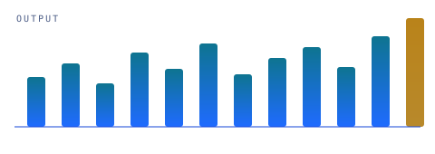
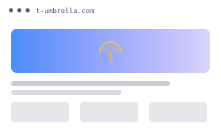
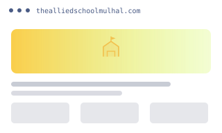

<picture>
  <source media="(prefers-color-scheme: dark)" srcset="globe-3d.svg">
  <source media="(prefers-color-scheme: light)" srcset="globe-3d-light.svg">
  
</picture>
<h1>M Rehan Al Hassan</h1>

<b>I build AI-powered tools, Chrome extensions and WordPress websites.</b>

Based in Pakistan · Working with clients worldwide

<b>Chrome Extensions</b> · <b>WordPress Websites</b> · <b>AI Automation</b>

<picture>
  <source media="(prefers-color-scheme: dark)" srcset="divider-dark.svg">
  <source media="(prefers-color-scheme: light)" srcset="divider-light.svg">
  
</picture>

## <picture><source media="(prefers-color-scheme: dark)" srcset="bullet-dark.svg"><source media="(prefers-color-scheme: light)" srcset="bullet-light.svg"></picture> AI automation & data

<table width="100%">
<tr>
<td align="center" valign="top" width="50%">
<picture><source media="(prefers-color-scheme: dark)" srcset="icon-spark-dark.svg"><source media="(prefers-color-scheme: light)" srcset="icon-spark-light.svg"></picture> 
<b>AI Workflows</b> 
Repetitive workflows turned into one-click systems
</td>
<td align="center" valign="top" width="50%">
<picture><source media="(prefers-color-scheme: dark)" srcset="icon-chart-dark.svg"><source media="(prefers-color-scheme: light)" srcset="icon-chart-light.svg"></picture> 
<b>Data Pipelines</b> 
Data collection and cleanup pipelines
</td>
</tr>
<tr>
<td align="center" valign="top" width="50%">
<picture><source media="(prefers-color-scheme: dark)" srcset="icon-notes-dark.svg"><source media="(prefers-color-scheme: light)" srcset="icon-notes-light.svg"></picture> 
<b>AI Drafting</b> 
AI-assisted drafting and review loops
</td>
<td align="center" valign="top" width="50%">
<picture><source media="(prefers-color-scheme: dark)" srcset="icon-puzzle-dark.svg"><source media="(prefers-color-scheme: light)" srcset="icon-puzzle-light.svg"></picture> 
<b>Automation Systems</b> 
Systems for startups &amp; agencies
</td>
</tr>
</table>

<picture>
  <source media="(prefers-color-scheme: dark)" srcset="ai-graph-dark.svg">
  <source media="(prefers-color-scheme: light)" srcset="ai-graph-light.svg">
  
</picture>

<picture>
  <source media="(prefers-color-scheme: dark)" srcset="divider-2-dark.svg">
  <source media="(prefers-color-scheme: light)" srcset="divider-2-light.svg">
  
</picture>

## <picture><source media="(prefers-color-scheme: dark)" srcset="bullet-dark.svg"><source media="(prefers-color-scheme: light)" srcset="bullet-light.svg"></picture> By the numbers

<table width="100%">
<tr>
<td align="center" width="50%">
<h3>20+</h3>

Projects delivered

</td>
<td align="center" width="50%">
<h3>6</h3>

Chrome extensions

</td>
</tr>
<tr>
<td align="center" width="50%">
<h3>3</h3>

Core services

</td>
<td align="center" width="50%">
<h3>3</h3>

Projects showcased

</td>
</tr>
</table>

<picture>
  <source media="(prefers-color-scheme: dark)" srcset="divider-3-dark.svg">
  <source media="(prefers-color-scheme: light)" srcset="divider-3-light.svg">
  
</picture>

## <picture><source media="(prefers-color-scheme: dark)" srcset="bullet-dark.svg"><source media="(prefers-color-scheme: light)" srcset="bullet-light.svg"></picture> Featured builds

<table width="100%">
<tr>
<td align="center" valign="top" width="50%">
<a href="https://t-umbrella.com/"><picture><source media="(prefers-color-scheme: dark)" srcset="assets/projects/t-umbrella-dark.svg"><source media="(prefers-color-scheme: light)" srcset="assets/projects/t-umbrella-light.svg"></picture></a> 
<b>T-Umbrella</b> · <a href="https://t-umbrella.com/">Visit ↗</a>
</td>
<td align="center" valign="top" width="50%">
<a href="https://darearqamschoolkhanpur.com/"><picture><source media="(prefers-color-scheme: dark)" srcset="assets/projects/dar-e-arqam-school-dark.svg"><source media="(prefers-color-scheme: light)" srcset="assets/projects/dar-e-arqam-school-light.svg"></picture></a> 
<b>Dar e Arqam School Khanpur</b> · <a href="https://darearqamschoolkhanpur.com/">Visit ↗</a>
</td>
</tr>
<tr>
<td align="center" valign="top" width="50%">
<a href="https://thealliedschoolmulhal.com/"><picture><source media="(prefers-color-scheme: dark)" srcset="assets/projects/allied-school-mulhal-dark.svg"><source media="(prefers-color-scheme: light)" srcset="assets/projects/allied-school-mulhal-light.svg"></picture></a> 
<b>The Allied School Mulhal</b> · <a href="https://thealliedschoolmulhal.com/">Visit ↗</a>
</td>

<td align="center" valign="middle" width="50%">
<h3>20+</h3>

Projects delivered

3 showcased here

</td></tr>
</table>

<picture>
  <source media="(prefers-color-scheme: dark)" srcset="divider-dark.svg">
  <source media="(prefers-color-scheme: light)" srcset="divider-light.svg">
  
</picture>

## <picture><source media="(prefers-color-scheme: dark)" srcset="bullet-dark.svg"><source media="(prefers-color-scheme: light)" srcset="bullet-light.svg"></picture> The extension shelf

<table width="100%">
<tr>
<td align="center" valign="top" width="50%">
<picture><source media="(prefers-color-scheme: dark)" srcset="icon-chart-dark.svg"><source media="(prefers-color-scheme: light)" srcset="icon-chart-light.svg"></picture> 
<b>Rank Tracker</b> 
Fiverr keyword and rank research
</td>
<td align="center" valign="top" width="50%">
<picture><source media="(prefers-color-scheme: dark)" srcset="icon-search-dark.svg"><source media="(prefers-color-scheme: light)" srcset="icon-search-light.svg"></picture> 
<b>Site Audit</b> 
SEO, design and performance checks
</td>
</tr>
<tr>
<td align="center" valign="top" width="50%">
<picture><source media="(prefers-color-scheme: dark)" srcset="icon-devices-dark.svg"><source media="(prefers-color-scheme: light)" srcset="icon-devices-light.svg"></picture> 
<b>Responsive Preview</b> 
every breakpoint at once
</td>
<td align="center" valign="top" width="50%">
<picture><source media="(prefers-color-scheme: dark)" srcset="icon-image-dark.svg"><source media="(prefers-color-scheme: light)" srcset="icon-image-light.svg"></picture> 
<b>Image Downloader</b> 
bulk image grabber
</td>
</tr>
<tr>
<td align="center" valign="top" width="50%">
<picture><source media="(prefers-color-scheme: dark)" srcset="icon-pin-dark.svg"><source media="(prefers-color-scheme: light)" srcset="icon-pin-light.svg"></picture> 
<b>Maps Scraper</b> 
Google Maps turned into lead lists
</td>
<td align="center" valign="top" width="50%">
<picture><source media="(prefers-color-scheme: dark)" srcset="icon-notes-dark.svg"><source media="(prefers-color-scheme: light)" srcset="icon-notes-light.svg"></picture> 
<b>Tasker Notes</b> 
notes, reminders and tasks
</td>
</tr>
</table>

<picture>
  <source media="(prefers-color-scheme: dark)" srcset="divider-2-dark.svg">
  <source media="(prefers-color-scheme: light)" srcset="divider-2-light.svg">
  
</picture>

## <picture><source media="(prefers-color-scheme: dark)" srcset="bullet-dark.svg"><source media="(prefers-color-scheme: light)" srcset="bullet-light.svg"></picture> Contact

- **Facebook:** [facebook.com/MRehanAlHassan](https://www.facebook.com/MRehanAlHassan)
- **LinkedIn:** [linkedin.com/in/mrehanalhassan](https://www.linkedin.com/in/mrehanalhassan/)
- **Blog:** [mrehanalhassan.blogspot.com](https://mrehanalhassan.blogspot.com/)
- **Email:** [therehanco@gmail.com](mailto:therehanco@gmail.com)
- **Phone/WhatsApp:** [+92 371 358 8966](https://wa.me/923713588966)

<picture>
  <source media="(prefers-color-scheme: dark)" srcset="footer3-dark.svg">
  <source media="(prefers-color-scheme: light)" srcset="footer3-light.svg">
  
</picture>
