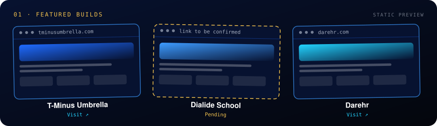

**[Open the interactive version](https://mrehanalhassan.github.io/mrehanalhassan/)** — the full animated page: 3D globe, skill explorer, tilt cards and the AI lab.

**Connect:** [LinkedIn](https://www.linkedin.com/in/mrehanalhassan/) · [Facebook](https://www.facebook.com/MRehanAlHassan) · [Blog](https://mrehanalhassan.blogspot.com/) · [Email](mailto:therehanco@gmail.com)

| Build | Link |
|---|---|
| **T-Minus Umbrella** | [tminusumbrella.com](https://tminusumbrella.com/) |
| **Dialide School** | link pending |
| **Darehr** | [darehr.com](https://darehr.com/) |

**Contact:** [Start a project](mailto:therehanco@gmail.com?subject=Project%20inquiry) · [LinkedIn](https://www.linkedin.com/in/mrehanalhassan/) · [Facebook](https://www.facebook.com/MRehanAlHassan) · [Blog](https://mrehanalhassan.blogspot.com/)
