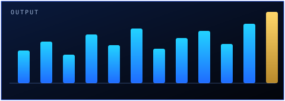
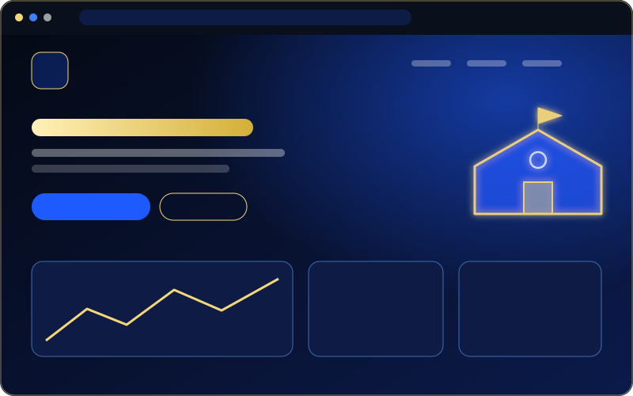

<table width="100%">
<tr>
<td align="center" valign="middle" width="42%">

</td>
<td align="center" valign="middle" width="58%">
<h1>M Rehan Al Hassan</h1>

<b>I build AI-powered tools, Chrome extensions and WordPress websites.</b>

Based in Pakistan · Working with clients worldwide

<b>Chrome Extensions</b> · <b>WordPress Websites</b> · <b>AI Automation</b>

</td>
</tr>
</table>

##  AI automation & data

<table width="100%">
<tr>
<td align="center" valign="top" width="25%">
 
<b>AI Workflows</b> 
Repetitive workflows turned into one-click systems
</td>
<td align="center" valign="top" width="25%">
 
<b>Data Pipelines</b> 
Data collection and cleanup pipelines
</td>
<td align="center" valign="top" width="25%">
 
<b>AI Drafting</b> 
AI-assisted drafting and review loops
</td>
<td align="center" valign="top" width="25%">
 
<b>Automation Systems</b> 
Systems for startups &amp; agencies
</td>
</tr>
<tr><td colspan="4"></td></tr>
</table>

##  By the numbers

<table width="100%">
<tr>
<td align="center" width="25%">
 
<h2>20+</h2>
Projects delivered
</td>
<td align="center" width="25%">
 
<h2>6</h2>
Chrome extensions
</td>
<td align="center" width="25%">
 
<h2>3</h2>
Core services
</td>
<td align="center" width="25%">
 
<h2>3</h2>
Projects showcased
</td>
</tr>
<tr><td colspan="4"></td></tr>
</table>

##  Featured builds

<table width="100%">
<tr>
<td align="center" valign="top" width="33%">
 
<b>T-Umbrella</b> · <a href="https://t-umbrella.com/">Visit ↗</a>
</td>
<td align="center" valign="top" width="33%">
 
<b>Dar e Arqam School Khanpur</b> · <a href="https://darearqamschoolkhanpur.com/">Visit ↗</a>
</td>
<td align="center" valign="top" width="33%">
 
<b>The Allied School Mulhal</b> · <a href="https://thealliedschoolmulhal.com/">Visit ↗</a>
</td>
</tr>
</table>

20+ projects delivered — 3 showcased here.

##  The extension shelf

<table width="100%">
<tr>
<td align="center" valign="top" width="33%">
 
<b>Rank Tracker</b> 
Fiverr keyword and rank research
</td>
<td align="center" valign="top" width="33%">
 
<b>Site Audit</b> 
SEO, design and performance checks
</td>
<td align="center" valign="top" width="33%">
 
<b>Responsive Preview</b> 
every breakpoint at once
</td>
</tr>
<tr>
<td align="center" valign="top" width="33%">
 
<b>Image Downloader</b> 
bulk image grabber
</td>
<td align="center" valign="top" width="33%">
 
<b>Maps Scraper</b> 
Google Maps turned into lead lists
</td>
<td align="center" valign="top" width="33%">
 
<b>Tasker Notes</b> 
notes, reminders and tasks
</td>
</tr>
<tr><td colspan="3"></td></tr>
</table>

##  Contact

- **Facebook:** [facebook.com/MRehanAlHassan](https://www.facebook.com/MRehanAlHassan)
- **LinkedIn:** [linkedin.com/in/mrehanalhassan](https://www.linkedin.com/in/mrehanalhassan/)
- **Blog:** [mrehanalhassan.blogspot.com](https://mrehanalhassan.blogspot.com/)
- **Email:** [therehanco@gmail.com](mailto:therehanco@gmail.com)
- **Phone/WhatsApp:** [+92 371 358 8966](https://wa.me/923713588966)

