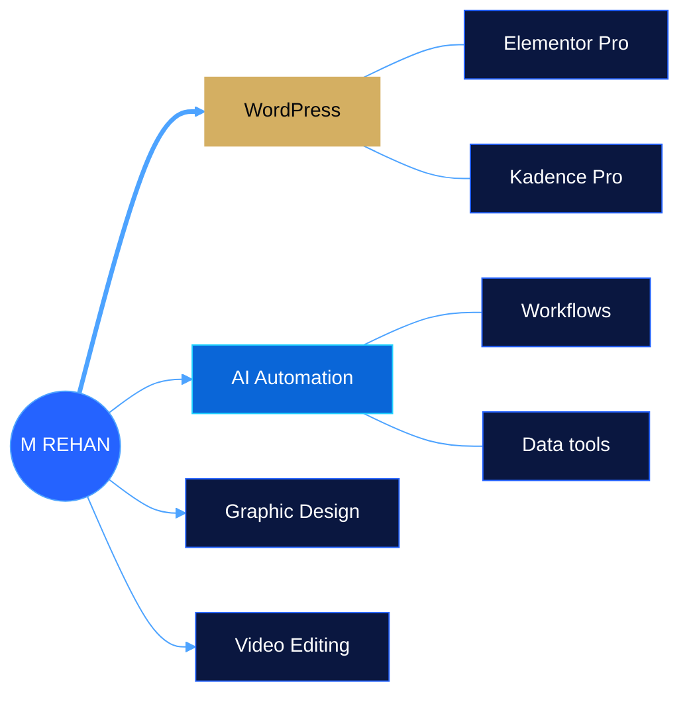

<h1 align="center">M REHAN AL HASSAN</h1>

> [!NOTE]
> **WordPress Developer · Digital Creator · AI Automation**
> Elementor Pro · Kadence Pro · business websites, redesigns and landing pages for clients in the USA, UK and Canada.

<p align="center">
<a href="https://www.linkedin.com/in/mrehanalhassan/"><b>LinkedIn</b></a> &nbsp;·&nbsp;
<a href="https://www.facebook.com/MRehanAlHassan"><b>Facebook</b></a> &nbsp;·&nbsp;
<a href="https://mrehanalhassan.blogspot.com/"><b>Blog</b></a> &nbsp;·&nbsp;
<a href="mailto:therehanco@gmail.com?subject=Project%20inquiry"><b>Start a project →</b></a>
</p>

## ◆ 3D identity <sub>drag to rotate</sub>

```stl
solid mrehan_monogram
 facet normal 0.000 -1.000 0.000
  outer loop
   vertex -12.50 0.00 0.00
   vertex -9.90 0.00 0.00
   vertex -9.90 0.00 14.00
  endloop
 endfacet
 facet normal 0.000 -1.000 0.000
  outer loop
   vertex -12.50 0.00 0.00
   vertex -9.90 0.00 14.00
   vertex -12.50 0.00 14.00
  endloop
 endfacet
 facet normal -0.000 1.000 -0.000
  outer loop
   vertex -12.50 3.00 0.00
   vertex -9.90 3.00 14.00
   vertex -9.90 3.00 0.00
  endloop
 endfacet
 facet normal -0.000 1.000 -0.000
  outer loop
   vertex -12.50 3.00 0.00
   vertex -12.50 3.00 14.00
   vertex -9.90 3.00 14.00
  endloop
 endfacet
 facet normal -0.000 -0.000 -1.000
  outer loop
   vertex -12.50 0.00 0.00
   vertex -9.90 3.00 0.00
   vertex -9.90 0.00 0.00
  endloop
 endfacet
 facet normal -0.000 -0.000 -1.000
  outer loop
   vertex -12.50 0.00 0.00
   vertex -12.50 3.00 0.00
   vertex -9.90 3.00 0.00
  endloop
 endfacet
 facet normal 1.000 -0.000 -0.000
  outer loop
   vertex -9.90 0.00 0.00
   vertex -9.90 3.00 14.00
   vertex -9.90 0.00 14.00
  endloop
 endfacet
 facet normal 1.000 -0.000 -0.000
  outer loop
   vertex -9.90 0.00 0.00
   vertex -9.90 3.00 0.00
   vertex -9.90 3.00 14.00
  endloop
 endfacet
 facet normal -0.000 -0.000 1.000
  outer loop
   vertex -9.90 0.00 14.00
   vertex -12.50 3.00 14.00
   vertex -12.50 0.00 14.00
  endloop
 endfacet
 facet normal -0.000 -0.000 1.000
  outer loop
   vertex -9.90 0.00 14.00
   vertex -9.90 3.00 14.00
   vertex -12.50 3.00 14.00
  endloop
 endfacet
 facet normal -1.000 -0.000 -0.000
  outer loop
   vertex -12.50 0.00 14.00
   vertex -12.50 3.00 0.00
   vertex -12.50 0.00 0.00
  endloop
 endfacet
 facet normal -1.000 -0.000 -0.000
  outer loop
   vertex -12.50 0.00 14.00
   vertex -12.50 3.00 14.00
   vertex -12.50 3.00 0.00
  endloop
 endfacet
 facet normal 0.000 -1.000 0.000
  outer loop
   vertex -3.10 0.00 0.00
   vertex -0.50 0.00 0.00
   vertex -0.50 0.00 14.00
  endloop
 endfacet
 facet normal 0.000 -1.000 0.000
  outer loop
   vertex -3.10 0.00 0.00
   vertex -0.50 0.00 14.00
   vertex -3.10 0.00 14.00
  endloop
 endfacet
 facet normal -0.000 1.000 -0.000
  outer loop
   vertex -3.10 3.00 0.00
   vertex -0.50 3.00 14.00
   vertex -0.50 3.00 0.00
  endloop
 endfacet
 facet normal -0.000 1.000 -0.000
  outer loop
   vertex -3.10 3.00 0.00
   vertex -3.10 3.00 14.00
   vertex -0.50 3.00 14.00
  endloop
 endfacet
 facet normal -0.000 -0.000 -1.000
  outer loop
   vertex -3.10 0.00 0.00
   vertex -0.50 3.00 0.00
   vertex -0.50 0.00 0.00
  endloop
 endfacet
 facet normal -0.000 -0.000 -1.000
  outer loop
   vertex -3.10 0.00 0.00
   vertex -3.10 3.00 0.00
   vertex -0.50 3.00 0.00
  endloop
 endfacet
 facet normal 1.000 -0.000 -0.000
  outer loop
   vertex -0.50 0.00 0.00
   vertex -0.50 3.00 14.00
   vertex -0.50 0.00 14.00
  endloop
 endfacet
 facet normal 1.000 -0.000 -0.000
  outer loop
   vertex -0.50 0.00 0.00
   vertex -0.50 3.00 0.00
   vertex -0.50 3.00 14.00
  endloop
 endfacet
 facet normal -0.000 -0.000 1.000
  outer loop
   vertex -0.50 0.00 14.00
   vertex -3.10 3.00 14.00
   vertex -3.10 0.00 14.00
  endloop
 endfacet
 facet normal -0.000 -0.000 1.000
  outer loop
   vertex -0.50 0.00 14.00
   vertex -0.50 3.00 14.00
   vertex -3.10 3.00 14.00
  endloop
 endfacet
 facet normal -1.000 -0.000 -0.000
  outer loop
   vertex -3.10 0.00 14.00
   vertex -3.10 3.00 0.00
   vertex -3.10 0.00 0.00
  endloop
 endfacet
 facet normal -1.000 0.000 -0.000
  outer loop
   vertex -3.10 0.00 14.00
   vertex -3.10 3.00 14.00
   vertex -3.10 3.00 0.00
  endloop
 endfacet
 facet normal -0.000 -1.000 -0.000
  outer loop
   vertex -12.50 0.00 14.00
   vertex -5.50 0.00 5.00
   vertex -9.50 0.00 14.00
  endloop
 endfacet
 facet normal -0.000 -1.000 -0.000
  outer loop
   vertex -12.50 0.00 14.00
   vertex -8.10 0.00 5.00
   vertex -5.50 0.00 5.00
  endloop
 endfacet
 facet normal 0.000 1.000 0.000
  outer loop
   vertex -12.50 3.00 14.00
   vertex -9.50 3.00 14.00
   vertex -5.50 3.00 5.00
  endloop
 endfacet
 facet normal 0.000 1.000 0.000
  outer loop
   vertex -12.50 3.00 14.00
   vertex -5.50 3.00 5.00
   vertex -8.10 3.00 5.00
  endloop
 endfacet
 facet normal 0.000 0.000 1.000
  outer loop
   vertex -12.50 0.00 14.00
   vertex -9.50 0.00 14.00
   vertex -9.50 3.00 14.00
  endloop
 endfacet
 facet normal 0.000 0.000 1.000
  outer loop
   vertex -12.50 0.00 14.00
   vertex -9.50 3.00 14.00
   vertex -12.50 3.00 14.00
  endloop
 endfacet
 facet normal 0.914 0.000 0.406
  outer loop
   vertex -9.50 0.00 14.00
   vertex -5.50 0.00 5.00
   vertex -5.50 3.00 5.00
  endloop
 endfacet
 facet normal 0.914 0.000 0.406
  outer loop
   vertex -9.50 0.00 14.00
   vertex -5.50 3.00 5.00
   vertex -9.50 3.00 14.00
  endloop
 endfacet
 facet normal 0.000 0.000 -1.000
  outer loop
   vertex -5.50 0.00 5.00
   vertex -8.10 0.00 5.00
   vertex -8.10 3.00 5.00
  endloop
 endfacet
 facet normal 0.000 0.000 -1.000
  outer loop
   vertex -5.50 0.00 5.00
   vertex -8.10 3.00 5.00
   vertex -5.50 3.00 5.00
  endloop
 endfacet
 facet normal -0.898 0.000 -0.439
  outer loop
   vertex -8.10 0.00 5.00
   vertex -12.50 0.00 14.00
   vertex -12.50 3.00 14.00
  endloop
 endfacet
 facet normal -0.898 0.000 -0.439
  outer loop
   vertex -8.10 0.00 5.00
   vertex -12.50 3.00 14.00
   vertex -8.10 3.00 5.00
  endloop
 endfacet
 facet normal 0.000 -1.000 0.000
  outer loop
   vertex -0.50 0.00 14.00
   vertex -3.50 0.00 14.00
   vertex -7.50 0.00 5.00
  endloop
 endfacet
 facet normal 0.000 -1.000 0.000
  outer loop
   vertex -0.50 0.00 14.00
   vertex -7.50 0.00 5.00
   vertex -4.90 0.00 5.00
  endloop
 endfacet
 facet normal -0.000 1.000 -0.000
  outer loop
   vertex -0.50 3.00 14.00
   vertex -7.50 3.00 5.00
   vertex -3.50 3.00 14.00
  endloop
 endfacet
 facet normal -0.000 1.000 -0.000
  outer loop
   vertex -0.50 3.00 14.00
   vertex -4.90 3.00 5.00
   vertex -7.50 3.00 5.00
  endloop
 endfacet
 facet normal -0.000 -0.000 1.000
  outer loop
   vertex -0.50 0.00 14.00
   vertex -3.50 3.00 14.00
   vertex -3.50 0.00 14.00
  endloop
 endfacet
 facet normal -0.000 -0.000 1.000
  outer loop
   vertex -0.50 0.00 14.00
   vertex -0.50 3.00 14.00
   vertex -3.50 3.00 14.00
  endloop
 endfacet
 facet normal -0.914 -0.000 0.406
  outer loop
   vertex -3.50 0.00 14.00
   vertex -7.50 3.00 5.00
   vertex -7.50 0.00 5.00
  endloop
 endfacet
 facet normal -0.914 -0.000 0.406
  outer loop
   vertex -3.50 0.00 14.00
   vertex -3.50 3.00 14.00
   vertex -7.50 3.00 5.00
  endloop
 endfacet
 facet normal -0.000 -0.000 -1.000
  outer loop
   vertex -7.50 0.00 5.00
   vertex -4.90 3.00 5.00
   vertex -4.90 0.00 5.00
  endloop
 endfacet
 facet normal -0.000 -0.000 -1.000
  outer loop
   vertex -7.50 0.00 5.00
   vertex -7.50 3.00 5.00
   vertex -4.90 3.00 5.00
  endloop
 endfacet
 facet normal 0.898 -0.000 -0.439
  outer loop
   vertex -4.90 0.00 5.00
   vertex -0.50 3.00 14.00
   vertex -0.50 0.00 14.00
  endloop
 endfacet
 facet normal 0.898 -0.000 -0.439
  outer loop
   vertex -4.90 0.00 5.00
   vertex -4.90 3.00 5.00
   vertex -0.50 3.00 14.00
  endloop
 endfacet
 facet normal 0.000 -1.000 0.000
  outer loop
   vertex 2.50 0.00 0.00
   vertex 5.10 0.00 0.00
   vertex 5.10 0.00 14.00
  endloop
 endfacet
 facet normal 0.000 -1.000 0.000
  outer loop
   vertex 2.50 0.00 0.00
   vertex 5.10 0.00 14.00
   vertex 2.50 0.00 14.00
  endloop
 endfacet
 facet normal -0.000 1.000 -0.000
  outer loop
   vertex 2.50 3.00 0.00
   vertex 5.10 3.00 14.00
   vertex 5.10 3.00 0.00
  endloop
 endfacet
 facet normal -0.000 1.000 -0.000
  outer loop
   vertex 2.50 3.00 0.00
   vertex 2.50 3.00 14.00
   vertex 5.10 3.00 14.00
  endloop
 endfacet
 facet normal -0.000 -0.000 -1.000
  outer loop
   vertex 2.50 0.00 0.00
   vertex 5.10 3.00 0.00
   vertex 5.10 0.00 0.00
  endloop
 endfacet
 facet normal -0.000 -0.000 -1.000
  outer loop
   vertex 2.50 0.00 0.00
   vertex 2.50 3.00 0.00
   vertex 5.10 3.00 0.00
  endloop
 endfacet
 facet normal 1.000 -0.000 -0.000
  outer loop
   vertex 5.10 0.00 0.00
   vertex 5.10 3.00 14.00
   vertex 5.10 0.00 14.00
  endloop
 endfacet
 facet normal 1.000 -0.000 -0.000
  outer loop
   vertex 5.10 0.00 0.00
   vertex 5.10 3.00 0.00
   vertex 5.10 3.00 14.00
  endloop
 endfacet
 facet normal -0.000 -0.000 1.000
  outer loop
   vertex 5.10 0.00 14.00
   vertex 2.50 3.00 14.00
   vertex 2.50 0.00 14.00
  endloop
 endfacet
 facet normal -0.000 -0.000 1.000
  outer loop
   vertex 5.10 0.00 14.00
   vertex 5.10 3.00 14.00
   vertex 2.50 3.00 14.00
  endloop
 endfacet
 facet normal -1.000 -0.000 -0.000
  outer loop
   vertex 2.50 0.00 14.00
   vertex 2.50 3.00 0.00
   vertex 2.50 0.00 0.00
  endloop
 endfacet
 facet normal -1.000 -0.000 -0.000
  outer loop
   vertex 2.50 0.00 14.00
   vertex 2.50 3.00 14.00
   vertex 2.50 3.00 0.00
  endloop
 endfacet
 facet normal 0.000 -1.000 0.000
  outer loop
   vertex 5.10 0.00 11.40
   vertex 10.50 0.00 11.40
   vertex 10.50 0.00 14.00
  endloop
 endfacet
 facet normal 0.000 -1.000 0.000
  outer loop
   vertex 5.10 0.00 11.40
   vertex 10.50 0.00 14.00
   vertex 5.10 0.00 14.00
  endloop
 endfacet
 facet normal -0.000 1.000 -0.000
  outer loop
   vertex 5.10 3.00 11.40
   vertex 10.50 3.00 14.00
   vertex 10.50 3.00 11.40
  endloop
 endfacet
 facet normal -0.000 1.000 -0.000
  outer loop
   vertex 5.10 3.00 11.40
   vertex 5.10 3.00 14.00
   vertex 10.50 3.00 14.00
  endloop
 endfacet
 facet normal -0.000 -0.000 -1.000
  outer loop
   vertex 5.10 0.00 11.40
   vertex 10.50 3.00 11.40
   vertex 10.50 0.00 11.40
  endloop
 endfacet
 facet normal -0.000 -0.000 -1.000
  outer loop
   vertex 5.10 0.00 11.40
   vertex 5.10 3.00 11.40
   vertex 10.50 3.00 11.40
  endloop
 endfacet
 facet normal 1.000 -0.000 -0.000
  outer loop
   vertex 10.50 0.00 11.40
   vertex 10.50 3.00 14.00
   vertex 10.50 0.00 14.00
  endloop
 endfacet
 facet normal 1.000 -0.000 -0.000
  outer loop
   vertex 10.50 0.00 11.40
   vertex 10.50 3.00 11.40
   vertex 10.50 3.00 14.00
  endloop
 endfacet
 facet normal -0.000 -0.000 1.000
  outer loop
   vertex 10.50 0.00 14.00
   vertex 5.10 3.00 14.00
   vertex 5.10 0.00 14.00
  endloop
 endfacet
 facet normal -0.000 -0.000 1.000
  outer loop
   vertex 10.50 0.00 14.00
   vertex 10.50 3.00 14.00
   vertex 5.10 3.00 14.00
  endloop
 endfacet
 facet normal -1.000 -0.000 -0.000
  outer loop
   vertex 5.10 0.00 14.00
   vertex 5.10 3.00 11.40
   vertex 5.10 0.00 11.40
  endloop
 endfacet
 facet normal -1.000 0.000 -0.000
  outer loop
   vertex 5.10 0.00 14.00
   vertex 5.10 3.00 14.00
   vertex 5.10 3.00 11.40
  endloop
 endfacet
 facet normal 0.000 -1.000 0.000
  outer loop
   vertex 5.10 0.00 6.00
   vertex 10.50 0.00 6.00
   vertex 10.50 0.00 8.60
  endloop
 endfacet
 facet normal 0.000 -1.000 0.000
  outer loop
   vertex 5.10 0.00 6.00
   vertex 10.50 0.00 8.60
   vertex 5.10 0.00 8.60
  endloop
 endfacet
 facet normal -0.000 1.000 -0.000
  outer loop
   vertex 5.10 3.00 6.00
   vertex 10.50 3.00 8.60
   vertex 10.50 3.00 6.00
  endloop
 endfacet
 facet normal -0.000 1.000 -0.000
  outer loop
   vertex 5.10 3.00 6.00
   vertex 5.10 3.00 8.60
   vertex 10.50 3.00 8.60
  endloop
 endfacet
 facet normal -0.000 -0.000 -1.000
  outer loop
   vertex 5.10 0.00 6.00
   vertex 10.50 3.00 6.00
   vertex 10.50 0.00 6.00
  endloop
 endfacet
 facet normal -0.000 -0.000 -1.000
  outer loop
   vertex 5.10 0.00 6.00
   vertex 5.10 3.00 6.00
   vertex 10.50 3.00 6.00
  endloop
 endfacet
 facet normal 1.000 -0.000 -0.000
  outer loop
   vertex 10.50 0.00 6.00
   vertex 10.50 3.00 8.60
   vertex 10.50 0.00 8.60
  endloop
 endfacet
 facet normal 1.000 -0.000 -0.000
  outer loop
   vertex 10.50 0.00 6.00
   vertex 10.50 3.00 6.00
   vertex 10.50 3.00 8.60
  endloop
 endfacet
 facet normal -0.000 -0.000 1.000
  outer loop
   vertex 10.50 0.00 8.60
   vertex 5.10 3.00 8.60
   vertex 5.10 0.00 8.60
  endloop
 endfacet
 facet normal -0.000 -0.000 1.000
  outer loop
   vertex 10.50 0.00 8.60
   vertex 10.50 3.00 8.60
   vertex 5.10 3.00 8.60
  endloop
 endfacet
 facet normal -1.000 -0.000 -0.000
  outer loop
   vertex 5.10 0.00 8.60
   vertex 5.10 3.00 6.00
   vertex 5.10 0.00 6.00
  endloop
 endfacet
 facet normal -1.000 0.000 -0.000
  outer loop
   vertex 5.10 0.00 8.60
   vertex 5.10 3.00 8.60
   vertex 5.10 3.00 6.00
  endloop
 endfacet
 facet normal 0.000 -1.000 0.000
  outer loop
   vertex 10.50 0.00 6.00
   vertex 13.10 0.00 6.80
   vertex 13.10 0.00 13.20
  endloop
 endfacet
 facet normal 0.000 -1.000 0.000
  outer loop
   vertex 10.50 0.00 6.00
   vertex 13.10 0.00 13.20
   vertex 10.50 0.00 14.00
  endloop
 endfacet
 facet normal -0.000 1.000 -0.000
  outer loop
   vertex 10.50 3.00 6.00
   vertex 13.10 3.00 13.20
   vertex 13.10 3.00 6.80
  endloop
 endfacet
 facet normal -0.000 1.000 -0.000
  outer loop
   vertex 10.50 3.00 6.00
   vertex 10.50 3.00 14.00
   vertex 13.10 3.00 13.20
  endloop
 endfacet
 facet normal 0.294 -0.000 -0.956
  outer loop
   vertex 10.50 0.00 6.00
   vertex 13.10 3.00 6.80
   vertex 13.10 0.00 6.80
  endloop
 endfacet
 facet normal 0.294 -0.000 -0.956
  outer loop
   vertex 10.50 0.00 6.00
   vertex 10.50 3.00 6.00
   vertex 13.10 3.00 6.80
  endloop
 endfacet
 facet normal 1.000 -0.000 -0.000
  outer loop
   vertex 13.10 0.00 6.80
   vertex 13.10 3.00 13.20
   vertex 13.10 0.00 13.20
  endloop
 endfacet
 facet normal 1.000 -0.000 -0.000
  outer loop
   vertex 13.10 0.00 6.80
   vertex 13.10 3.00 6.80
   vertex 13.10 3.00 13.20
  endloop
 endfacet
 facet normal 0.294 -0.000 0.956
  outer loop
   vertex 13.10 0.00 13.20
   vertex 10.50 3.00 14.00
   vertex 10.50 0.00 14.00
  endloop
 endfacet
 facet normal 0.294 -0.000 0.956
  outer loop
   vertex 13.10 0.00 13.20
   vertex 13.10 3.00 13.20
   vertex 10.50 3.00 14.00
  endloop
 endfacet
 facet normal -1.000 -0.000 -0.000
  outer loop
   vertex 10.50 0.00 14.00
   vertex 10.50 3.00 6.00
   vertex 10.50 0.00 6.00
  endloop
 endfacet
 facet normal -1.000 -0.000 -0.000
  outer loop
   vertex 10.50 0.00 14.00
   vertex 10.50 3.00 14.00
   vertex 10.50 3.00 6.00
  endloop
 endfacet
 facet normal -0.000 -1.000 -0.000
  outer loop
   vertex 6.90 0.00 6.00
   vertex 13.30 0.00 0.00
   vertex 9.70 0.00 6.00
  endloop
 endfacet
 facet normal -0.000 -1.000 -0.000
  outer loop
   vertex 6.90 0.00 6.00
   vertex 10.50 0.00 0.00
   vertex 13.30 0.00 0.00
  endloop
 endfacet
 facet normal 0.000 1.000 0.000
  outer loop
   vertex 6.90 3.00 6.00
   vertex 9.70 3.00 6.00
   vertex 13.30 3.00 0.00
  endloop
 endfacet
 facet normal 0.000 1.000 0.000
  outer loop
   vertex 6.90 3.00 6.00
   vertex 13.30 3.00 0.00
   vertex 10.50 3.00 0.00
  endloop
 endfacet
 facet normal 0.000 0.000 1.000
  outer loop
   vertex 6.90 0.00 6.00
   vertex 9.70 0.00 6.00
   vertex 9.70 3.00 6.00
  endloop
 endfacet
 facet normal 0.000 0.000 1.000
  outer loop
   vertex 6.90 0.00 6.00
   vertex 9.70 3.00 6.00
   vertex 6.90 3.00 6.00
  endloop
 endfacet
 facet normal 0.857 0.000 0.514
  outer loop
   vertex 9.70 0.00 6.00
   vertex 13.30 0.00 0.00
   vertex 13.30 3.00 0.00
  endloop
 endfacet
 facet normal 0.857 -0.000 0.514
  outer loop
   vertex 9.70 0.00 6.00
   vertex 13.30 3.00 0.00
   vertex 9.70 3.00 6.00
  endloop
 endfacet
 facet normal 0.000 0.000 -1.000
  outer loop
   vertex 13.30 0.00 0.00
   vertex 10.50 0.00 0.00
   vertex 10.50 3.00 0.00
  endloop
 endfacet
 facet normal 0.000 0.000 -1.000
  outer loop
   vertex 13.30 0.00 0.00
   vertex 10.50 3.00 0.00
   vertex 13.30 3.00 0.00
  endloop
 endfacet
 facet normal -0.857 0.000 -0.514
  outer loop
   vertex 10.50 0.00 0.00
   vertex 6.90 0.00 6.00
   vertex 6.90 3.00 6.00
  endloop
 endfacet
 facet normal -0.857 0.000 -0.514
  outer loop
   vertex 10.50 0.00 0.00
   vertex 6.90 3.00 6.00
   vertex 10.50 3.00 0.00
  endloop
 endfacet
 facet normal 0.000 -1.000 0.000
  outer loop
   vertex -15.50 -2.00 -3.00
   vertex 15.50 -2.00 -3.00
   vertex 15.50 -2.00 -1.00
  endloop
 endfacet
 facet normal 0.000 -1.000 0.000
  outer loop
   vertex -15.50 -2.00 -3.00
   vertex 15.50 -2.00 -1.00
   vertex -15.50 -2.00 -1.00
  endloop
 endfacet
 facet normal -0.000 1.000 -0.000
  outer loop
   vertex -15.50 6.00 -3.00
   vertex 15.50 6.00 -1.00
   vertex 15.50 6.00 -3.00
  endloop
 endfacet
 facet normal -0.000 1.000 -0.000
  outer loop
   vertex -15.50 6.00 -3.00
   vertex -15.50 6.00 -1.00
   vertex 15.50 6.00 -1.00
  endloop
 endfacet
 facet normal -0.000 -0.000 -1.000
  outer loop
   vertex -15.50 -2.00 -3.00
   vertex 15.50 6.00 -3.00
   vertex 15.50 -2.00 -3.00
  endloop
 endfacet
 facet normal -0.000 -0.000 -1.000
  outer loop
   vertex -15.50 -2.00 -3.00
   vertex -15.50 6.00 -3.00
   vertex 15.50 6.00 -3.00
  endloop
 endfacet
 facet normal 1.000 -0.000 -0.000
  outer loop
   vertex 15.50 -2.00 -3.00
   vertex 15.50 6.00 -1.00
   vertex 15.50 -2.00 -1.00
  endloop
 endfacet
 facet normal 1.000 -0.000 -0.000
  outer loop
   vertex 15.50 -2.00 -3.00
   vertex 15.50 6.00 -3.00
   vertex 15.50 6.00 -1.00
  endloop
 endfacet
 facet normal -0.000 -0.000 1.000
  outer loop
   vertex 15.50 -2.00 -1.00
   vertex -15.50 6.00 -1.00
   vertex -15.50 -2.00 -1.00
  endloop
 endfacet
 facet normal -0.000 -0.000 1.000
  outer loop
   vertex 15.50 -2.00 -1.00
   vertex 15.50 6.00 -1.00
   vertex -15.50 6.00 -1.00
  endloop
 endfacet
 facet normal -1.000 -0.000 -0.000
  outer loop
   vertex -15.50 -2.00 -1.00
   vertex -15.50 6.00 -3.00
   vertex -15.50 -2.00 -3.00
  endloop
 endfacet
 facet normal -1.000 -0.000 -0.000
  outer loop
   vertex -15.50 -2.00 -1.00
   vertex -15.50 6.00 -1.00
   vertex -15.50 6.00 -3.00
  endloop
 endfacet
endsolid mrehan_monogram
```

## ◆ Skills <sub>click to open</sub>



<details>
<summary>◆ <b>WordPress</b> &nbsp;<sub>main focus</sub></summary>

```bash
$ rehan --skill wordpress
# business sites · redesigns · landing pages
```

</details>

<details>
<summary>◆ <b>Elementor Pro</b></summary>

```bash
$ rehan --skill elementor-pro
# custom layouts · visual builds
```

</details>

<details>
<summary>◆ <b>Kadence Pro</b></summary>

```bash
$ rehan --skill kadence-pro
# flexible block-based builds
```

</details>

<details>
<summary>✦ <b>AI Automation</b></summary>

```bash
$ rehan --skill ai-automation
# workflows · data tools · experiments
```

</details>

<details>
<summary>◐ <b>Graphic Design</b></summary>

```bash
$ rehan --skill graphic-design
# social · brand visuals
```

</details>

<details>
<summary>▶ <b>Video Editing</b></summary>

```bash
$ rehan --skill video-editing
# promos · motion
```

</details>

## ◆ Clients <sub>pan, zoom, click the markers</sub>

```geojson
{"type":"FeatureCollection","features":[{"type":"Feature","properties":{"title":"Chakwal, Pakistan","description":"Home base","marker-color":"#D4AF62","marker-size":"large"},"geometry":{"type":"Point","coordinates":[72.85,32.93]}},{"type":"Feature","properties":{"title":"USA","description":"Client market","marker-color":"#2563FF","marker-size":"medium"},"geometry":{"type":"Point","coordinates":[-98,39]}},{"type":"Feature","properties":{"stroke":"#D4AF62","stroke-width":2,"stroke-opacity":0.95},"geometry":{"type":"LineString","coordinates":[[72.85,32.93],[72.23,36.74],[71.54,40.54],[70.77,44.34],[69.9,48.14],[68.88,51.92],[67.68,55.7],[66.22,59.46],[64.4,63.2],[62.04,66.91],[58.83,70.58],[54.23,74.16],[47.09,77.59],[34.98,80.7],[13.1,83.05],[-20.21,83.71],[-49.69,82.24],[-66.91,79.5],[-76.57,76.22],[-82.49,72.72],[-86.43,69.1],[-89.25,65.41],[-91.36,61.69],[-93.02,57.94],[-94.37,54.17],[-95.49,50.39],[-96.44,46.6],[-97.27,42.8],[-98.0,39.0]]}},{"type":"Feature","properties":{"title":"UK","description":"Client market","marker-color":"#2563FF","marker-size":"medium"},"geometry":{"type":"Point","coordinates":[-2,54]}},{"type":"Feature","properties":{"stroke":"#D4AF62","stroke-width":2,"stroke-opacity":0.95},"geometry":{"type":"LineString","coordinates":[[72.85,32.93],[71.2,34.35],[69.49,35.75],[67.72,37.12],[65.89,38.46],[63.99,39.78],[62.01,41.06],[59.96,42.31],[57.83,43.52],[55.61,44.69],[53.3,45.81],[50.9,46.89],[48.4,47.91],[45.8,48.88],[43.11,49.79],[40.31,50.63],[37.42,51.4],[34.43,52.1],[31.36,52.72],[28.2,53.26],[24.97,53.71],[21.67,54.08],[18.32,54.35],[14.94,54.53],[11.53,54.62],[8.12,54.6],[4.71,54.5],[1.34,54.3],[-2.0,54.0]]}},{"type":"Feature","properties":{"title":"Canada","description":"Client market","marker-color":"#2563FF","marker-size":"medium"},"geometry":{"type":"Point","coordinates":[-106,56]}},{"type":"Feature","properties":{"stroke":"#D4AF62","stroke-width":2,"stroke-opacity":0.95},"geometry":{"type":"LineString","coordinates":[[72.85,32.93],[72.8,36.18],[72.76,39.43],[72.7,42.69],[72.64,45.94],[72.57,49.19],[72.5,52.44],[72.41,55.69],[72.3,58.95],[72.18,62.2],[72.02,65.45],[71.81,68.7],[71.54,71.95],[71.16,75.2],[70.56,78.45],[69.5,81.7],[67.09,84.94],[56.33,88.14],[-86.68,88.43],[-100.3,85.24],[-102.95,82.0],[-104.08,78.76],[-104.71,75.51],[-105.11,72.26],[-105.39,69.01],[-105.6,65.76],[-105.76,62.5],[-105.89,59.25],[-106.0,56.0]]}}]}
```

## ◆ Featured builds

| Site | Link |
|:--|:--|
| ◆ **T-Minus Umbrella** | [tminusumbrella.com ↗](https://tminusumbrella.com/) |
| ◇ **Dialide School** | link to be confirmed |
| ◆ **Darehr** | [darehr.com ↗](https://darehr.com/) |

## ◆ AI automation & data <sub>concept · click to open</sub>

<details>
<summary><b>AI workflows</b></summary>


_Concept: intelligent workflows that route and complete tasks._

</details>

<details>
<summary><b>Data viz</b></summary>


_Concept: raw data turned into readable visuals._

</details>

<details>
<summary><b>Productivity</b></summary>


_Concept: AI-assisted productivity flow._

</details>

<details>
<summary><b>Experiments</b></summary>


_In progress: Fiverr Intelligence, a Chrome extension (design stage)._

</details>

<details>
<summary><b>Output preview</b> <sub>simulated data</sub></summary>

```text
output  ▂▅▃▇▄█▆▅▇█▆▇   (simulated)
```

</details>

## ◆ By the numbers

| 3 | 2023 | 3 | 3 |
|:-:|:-:|:-:|:-:|
| featured builds | working since | certificates | client markets |

<details>
<summary><b>Certificates</b></summary>

```text
Advanced WordPress & Kadence/Elementor Website Design  ·  Wisdom Academy  ·  June 2023
Professional Video Editing & Motion Design             ·  Info Tech Institute  ·  June 2023
Creative Graphic Design & Branding                     ·  Info Tech Institute  ·  May 2022
```

</details>
