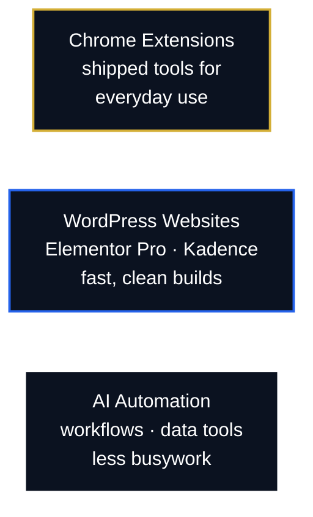

### I build AI-powered tools, Chrome extensions and WordPress websites.
**MR ToolLab** · Based in Pakistan · Working with clients worldwide

---

## What I do

---

## The extension shelf

<table>
<tr>
<td><b>Rank Tracker</b> Fiverr keyword and rank research</td>
<td><b>Site Audit</b> SEO, design and performance checks</td>
<td><b>Responsive Preview</b> every breakpoint at once</td>
</tr>
<tr>
<td><b>Image Downloader</b> bulk image grabber</td>
<td><b>Maps Scraper</b> Google Maps turned into lead lists</td>
<td><b>Tasker Notes</b> notes, reminders and tasks</td>
</tr>
</table>

---

## Selected work

- **T-Minus Umbrella** — contractor website, design and build
- **Dar e Arqam School, Khanpur** — school website
- **The Allied School, Mulhal** — school website

Live links shared on request.

---

## Contact

[LinkedIn](https://www.linkedin.com/in/mrrehanofficial/) · [Facebook](https://www.facebook.com/MRehanAlHassan) · [Blog](https://mrehanalhassan.blogspot.com/) · [Start a project →](mailto:therehanco@gmail.com?subject=Project%20inquiry)
