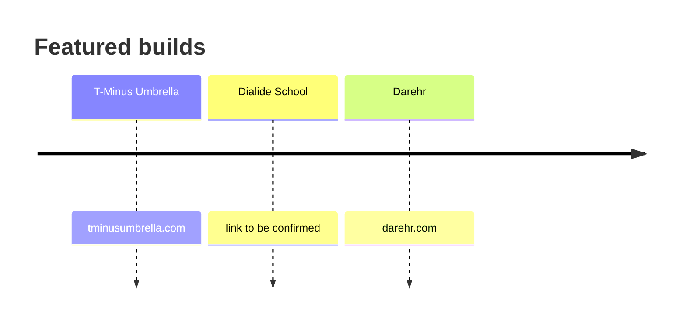
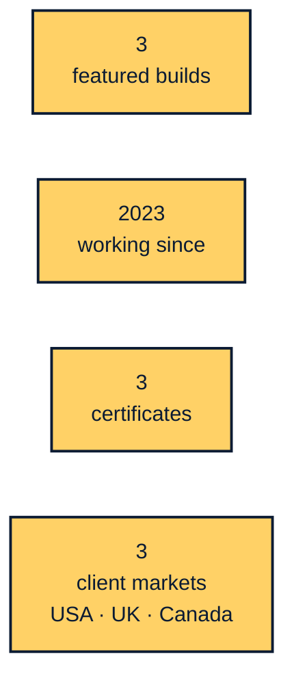

# M Rehan Al Hassan
### WordPress Developer · Digital Creator · AI Automation
Pakistan · Clients: USA · UK · Canada

[LinkedIn](https://www.linkedin.com/in/mrehanalhassan/) · [Facebook](https://www.facebook.com/MRehanAlHassan) · [Blog](https://mrehanalhassan.blogspot.com/) · [Start a project →](mailto:therehanco@gmail.com?subject=Project%20inquiry)

---

## Skills

```mermaid
flowchart TD
    ME(["M Rehan Al Hassan<br/>WordPress · Elementor · AI Automation"])
    subgraph WEB["Web development"]
        WP["WordPress<br/>main focus"]
        EL["Elementor Pro"]
        KA["Kadence Pro"]
    end
    subgraph CREATE["Creative + AI"]
        AI["AI Automation"]
        GD["Graphic Design"]
        VE["Video Editing"]
    end
    ME --> WEB & CREATE
    WP --> WP1["Business sites · redesigns · landing pages"]
    EL --> EL1["Custom layouts · visual builds"]
    KA --> KA1["Lightweight · fast sites"]
    AI --> AI1["Workflows · data tools"]
    GD --> GD1["Branding · creatives"]
    VE --> VE1["Edits · motion design"]
    classDef me fill:#0B1B33,stroke:#FFD166,stroke-width:3px,color:#FFFFFF
    classDef skill fill:#1F6FEB,stroke:#FFD166,stroke-width:2px,color:#FFFFFF
    classDef sub fill:#161B22,stroke:#1F6FEB,color:#C9D1D9
    class ME me
    class WP,EL,KA,AI,GD,VE skill
    class WP1,EL1,KA1,AI1,GD1,VE1 sub
    style WEB fill:#05070D,stroke:#1F6FEB,stroke-dasharray:5 5
    style CREATE fill:#05070D,stroke:#FFD166,stroke-dasharray:5 5
```



<details>
<summary><b>WordPress</b> — main focus</summary>

```
$ rehan --skill wordpress
> business sites · redesigns · landing pages
```

</details>

<details>
<summary><b>Elementor Pro</b></summary>

```
$ rehan --skill elementor-pro
> custom layouts · visual builds
```

</details>

<details>
<summary><b>Kadence Pro</b></summary>

```
$ rehan --skill kadence-pro
> lightweight fast sites
```

</details>

<details>
<summary><b>AI Automation</b></summary>

```
$ rehan --skill ai-automation
> workflows · data tools
```

</details>

<details>
<summary><b>Graphic Design</b></summary>

```
$ rehan --skill graphic-design
> branding · creatives
```

</details>

<details>
<summary><b>Video Editing</b></summary>

```
$ rehan --skill video-editing
> edits · motion design
```

</details>

---

## Featured builds



- [T-Minus Umbrella →](https://tminusumbrella.com/)
- Dialide School — link to be confirmed
- [Darehr →](https://darehr.com/)

---

## By the numbers



---

## Clients

<sub>Pan and zoom the map, click the markers</sub>

```geojson
{"type":"FeatureCollection","features":[{"type":"Feature","properties":{"title":"Chakwal, Pakistan","description":"Home base","marker-color":"#D4AF62","marker-size":"large"},"geometry":{"type":"Point","coordinates":[72.85,32.93]}},{"type":"Feature","properties":{"title":"USA","description":"Client market","marker-color":"#2563FF","marker-size":"medium"},"geometry":{"type":"Point","coordinates":[-98,39]}},{"type":"Feature","properties":{"stroke":"#D4AF62","stroke-width":2,"stroke-opacity":0.95},"geometry":{"type":"LineString","coordinates":[[72.85,32.93],[72.23,36.74],[71.54,40.54],[70.77,44.34],[69.9,48.14],[68.88,51.92],[67.68,55.7],[66.22,59.46],[64.4,63.2],[62.04,66.91],[58.83,70.58],[54.23,74.16],[47.09,77.59],[34.98,80.7],[13.1,83.05],[-20.21,83.71],[-49.69,82.24],[-66.91,79.5],[-76.57,76.22],[-82.49,72.72],[-86.43,69.1],[-89.25,65.41],[-91.36,61.69],[-93.02,57.94],[-94.37,54.17],[-95.49,50.39],[-96.44,46.6],[-97.27,42.8],[-98.0,39.0]]}},{"type":"Feature","properties":{"title":"UK","description":"Client market","marker-color":"#2563FF","marker-size":"medium"},"geometry":{"type":"Point","coordinates":[-2,54]}},{"type":"Feature","properties":{"stroke":"#D4AF62","stroke-width":2,"stroke-opacity":0.95},"geometry":{"type":"LineString","coordinates":[[72.85,32.93],[71.2,34.35],[69.49,35.75],[67.72,37.12],[65.89,38.46],[63.99,39.78],[62.01,41.06],[59.96,42.31],[57.83,43.52],[55.61,44.69],[53.3,45.81],[50.9,46.89],[48.4,47.91],[45.8,48.88],[43.11,49.79],[40.31,50.63],[37.42,51.4],[34.43,52.1],[31.36,52.72],[28.2,53.26],[24.97,53.71],[21.67,54.08],[18.32,54.35],[14.94,54.53],[11.53,54.62],[8.12,54.6],[4.71,54.5],[1.34,54.3],[-2.0,54.0]]}},{"type":"Feature","properties":{"title":"Canada","description":"Client market","marker-color":"#2563FF","marker-size":"medium"},"geometry":{"type":"Point","coordinates":[-106,56]}},{"type":"Feature","properties":{"stroke":"#D4AF62","stroke-width":2,"stroke-opacity":0.95},"geometry":{"type":"LineString","coordinates":[[72.85,32.93],[72.8,36.18],[72.76,39.43],[72.7,42.69],[72.64,45.94],[72.57,49.19],[72.5,52.44],[72.41,55.69],[72.3,58.95],[72.18,62.2],[72.02,65.45],[71.81,68.7],[71.54,71.95],[71.16,75.2],[70.56,78.45],[69.5,81.7],[67.09,84.94],[56.33,88.14],[-86.68,88.43],[-100.3,85.24],[-102.95,82.0],[-104.08,78.76],[-104.71,75.51],[-105.11,72.26],[-105.39,69.01],[-105.6,65.76],[-105.76,62.5],[-105.89,59.25],[-106.0,56.0]]}}]}
```

---

## AI automation & data

<details>
<summary><b>AI workflows</b> — click to open</summary>


</details>

<details>
<summary><b>Data viz</b> — click to open</summary>


</details>

<details>
<summary><b>Productivity</b> — click to open</summary>


</details>

<details>
<summary><b>Experiments</b> — click to open</summary>


</details>

---

## Certificates

<details>
<summary><b>Certificates</b> — click to open</summary>

- **Advanced WordPress and Kadence/Elementor Website Design** · Wisdom Academy · June 2023
- **Professional Video Editing and Motion Design** · Info Tech Institute · June 2023
- **Creative Graphic Design and Branding** · Info Tech Institute · May 2022

</details>

---

## Contact

[LinkedIn](https://www.linkedin.com/in/mrehanalhassan/) · [Facebook](https://www.facebook.com/MRehanAlHassan) · [Blog](https://mrehanalhassan.blogspot.com/) · [Start a project →](mailto:therehanco@gmail.com?subject=Project%20inquiry)
