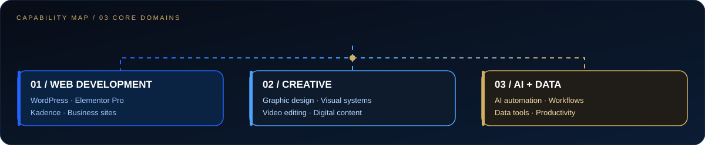
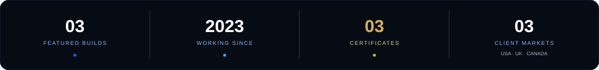

<!--
PROFILE REDESIGN PREVIEW
All graphics in this profile are hand-coded SVG, not screenshots or raster images.
GitHub README security restrictions do not permit arbitrary JavaScript or a custom page runtime.
-->

  

  <a href="https://www.linkedin.com/in/mrehanalhassan/"><strong>LINKEDIN</strong></a>
  &nbsp;·&nbsp;
  <a href="https://www.facebook.com/MRehanAlHassan"><strong>FACEBOOK</strong></a>
  &nbsp;·&nbsp;
  <a href="https://mrehanalhassan.blogspot.com/"><strong>BLOG</strong></a>
  &nbsp;·&nbsp;
  <a href="mailto:therehanco@gmail.com?subject=Project%20inquiry"><strong>START A PROJECT ↗</strong></a>

---

## CAPABILITY SYSTEM

  

<table>
  <tr>
    <td width="33%" valign="top">

**01 / WEB DEVELOPMENT**

- WordPress
- Elementor / Elementor Pro
- Kadence
- Business websites
- Website redesigns
- Landing pages

    </td>
    <td width="33%" valign="top">

**02 / CREATIVE**

- Graphic design
- Visual systems
- Branding and digital content
- Video editing
- Motion design

    </td>
    <td width="33%" valign="top">

**03 / AI + DATA**

- AI-assisted workflows
- Automation concepts
- Data tools and visualization
- Productivity systems
- Rapid prototyping

    </td>
  </tr>
</table>

---

## PROFILE METRICS

  

Profile details shown here reflect the information currently available; they are not third-party verified performance metrics.

---

## SELECTED BUILDS

<table>
  <tr>
    <td width="33%" valign="top">

**01 / T-MINUS UMBRELLA**

A featured website project.

<a href="https://tminusumbrella.com/">Open website ↗</a>

    </td>
    <td width="33%" valign="top">

**02 / DIALIDE SCHOOL**

A featured website project.

Website URL needs confirmation before adding a link.

    </td>
    <td width="33%" valign="top">

**03 / DAREHR**

A featured website project.

<a href="https://darehr.com/">Open website ↗</a>

    </td>
  </tr>
</table>

---

## AI AUTOMATION / DATA FLOW

  

The goal: turn repetitive steps into clearer workflows, useful tools, and easier-to-understand data.

---

## CERTIFICATIONS

<table>
  <tr>
    <td valign="top" width="50%">

**ADVANCED WEBSITE DESIGN**

WordPress and Kadence / Elementor Website Design  
Wisdom Academy · June 2023

    </td>
    <td valign="top" width="50%">

**VIDEO EDITING + MOTION DESIGN**

Professional Video Editing and Motion Design  
Info Tech Institute · June 2023

    </td>
  </tr>
  <tr>
    <td valign="top" width="50%">

**GRAPHIC DESIGN + BRANDING**

Creative Graphic Design and Branding  
Info Tech Institute · May 2022

    </td>
    <td valign="top" width="50%">

**WORKING STYLE**

Structured builds · Visual-first thinking · Practical automation

    </td>
  </tr>
</table>

---

## LOCATION + COLLABORATION

**Based in:** Chakwal, Pakistan  
**Client markets:** USA · UK · Canada

  <a href="https://www.linkedin.com/in/mrehanalhassan/">Connect on LinkedIn ↗</a>
  &nbsp;·&nbsp;
  <a href="https://www.facebook.com/MRehanAlHassan">Facebook ↗</a>
  &nbsp;·&nbsp;
  <a href="https://mrehanalhassan.blogspot.com/">Read the blog ↗</a>
  &nbsp;·&nbsp;
  <a href="mailto:therehanco@gmail.com?subject=Project%20inquiry">Email about a project ↗</a>

Designed in code · Deep navy · Electric blue · White · Gold

