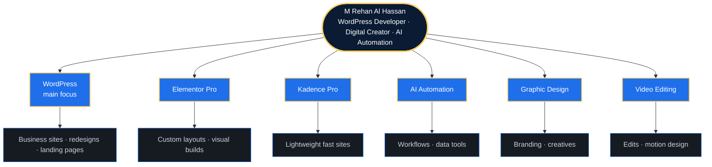
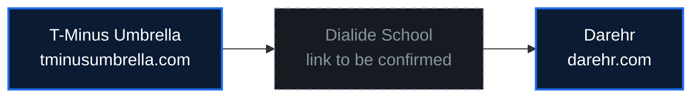
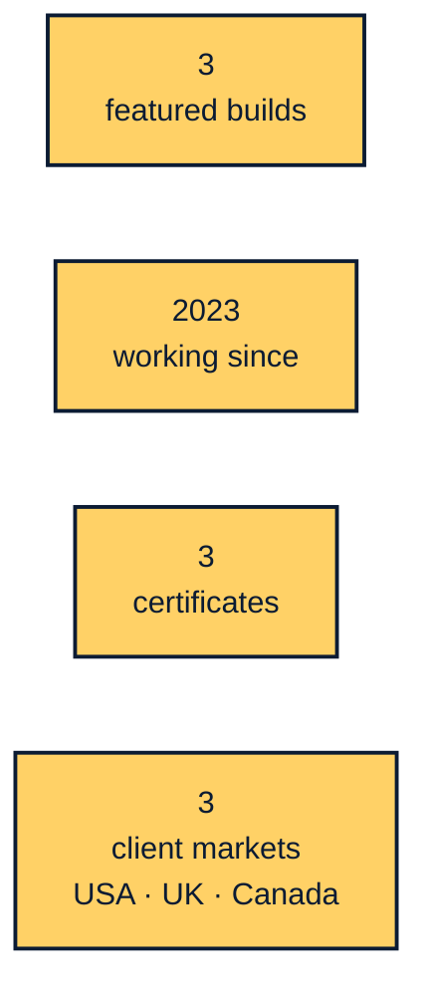
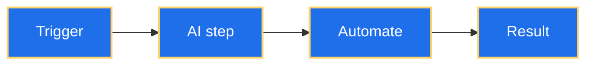
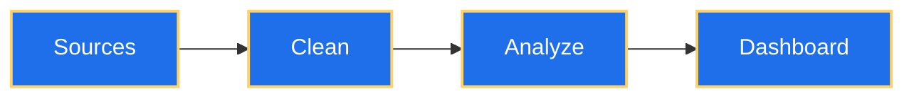
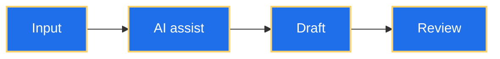
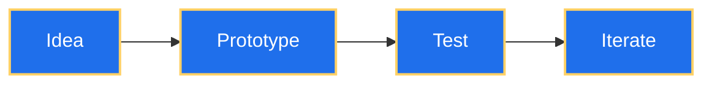

# M Rehan Al Hassan
### WordPress Developer · Digital Creator · AI Automation
Pakistan · Clients: USA · UK · Canada

[LinkedIn](https://www.linkedin.com/in/mrehanalhassan/) · [Facebook](https://www.facebook.com/MRehanAlHassan) · [Blog](https://mrehanalhassan.blogspot.com/) · [Start a project →](mailto:therehanco@gmail.com?subject=Project%20inquiry)

---

## Skills



<details>
<summary><b>WordPress</b> — main focus</summary>

```
$ rehan --skill wordpress
> business sites · redesigns · landing pages
```

</details>

<details>
<summary><b>Elementor Pro</b></summary>

```
$ rehan --skill elementor-pro
> custom layouts · visual builds
```

</details>

<details>
<summary><b>Kadence Pro</b></summary>

```
$ rehan --skill kadence-pro
> lightweight fast sites
```

</details>

<details>
<summary><b>AI Automation</b></summary>

```
$ rehan --skill ai-automation
> workflows · data tools
```

</details>

<details>
<summary><b>Graphic Design</b></summary>

```
$ rehan --skill graphic-design
> branding · creatives
```

</details>

<details>
<summary><b>Video Editing</b></summary>

```
$ rehan --skill video-editing
> edits · motion design
```

</details>

---

## Featured builds



- [T-Minus Umbrella →](https://tminusumbrella.com/)
- Dialide School — link to be confirmed
- [Darehr →](https://darehr.com/)

---

## By the numbers



---

## AI automation and data

<details>
<summary><b>AI workflows</b> — click to open</summary>



</details>

<details>
<summary><b>Data viz</b> — click to open</summary>



</details>

<details>
<summary><b>Productivity</b> — click to open</summary>



</details>

<details>
<summary><b>Experiments</b> — click to open</summary>



</details>

---

## Certificates

<details>
<summary><b>Certificates</b> — click to open</summary>

- **Advanced WordPress and Kadence/Elementor Website Design** · Wisdom Academy · June 2023
- **Professional Video Editing and Motion Design** · Info Tech Institute · June 2023
- **Creative Graphic Design and Branding** · Info Tech Institute · May 2022

</details>

---

## Contact

[LinkedIn](https://www.linkedin.com/in/mrehanalhassan/) · [Facebook](https://www.facebook.com/MRehanAlHassan) · [Blog](https://mrehanalhassan.blogspot.com/) · [Start a project →](mailto:therehanco@gmail.com?subject=Project%20inquiry)

*100% code — no images, no files, no embeds.*
